<p align="center">
  <a href="https://thiagoribeiro.github.io/lunardyson/"></a>
</p>

<p align="center">
  <a href="https://thiagoribeiro.github.io/lunardyson/"><b>Website</b></a> ·
  <a href="SECURITY.md">Security model</a> ·
  <a href="SPIKE.md">Spike report &amp; benchmarks</a> ·
  <a href="include/lunardyson.h">C ABI</a>
</p>

<p align="center">
  
  
  
  <a href="https://github.com/thiagoribeiro/lunardyson/actions/workflows/ci.yml"></a>
  <a href="https://github.com/thiagoribeiro/lunardyson/actions/workflows/fuzz.yml"></a>
</p>

---

**Let the model write the program. Decide what it can touch.**

Agents usually orchestrate tools one model call at a time: `LLM → tool → LLM → tool → …`.
Every step pays latency and tokens, and the path can change between runs. Asking the model
for **one small program** and running it deterministically is cheaper and repeatable. The
catch is that you are now running code nobody reviewed.

LunarDyson runs that code. A host (in any language) hands it a Luau program. The program
runs in a sandboxed [Luau](https://luau.org) VM, and the only way it can reach the outside
world is through the **tools the host registered**, each with its own budget. Before it runs,
the program is type-checked against those tools. While it runs, everything it does is
metered.

## What you get

| | |
|---|---|
| **Default deny** | No `os`, `io`, `debug`, `require`, `load*`, `getfenv`/`setfenv` or `coroutine`; `print` is a no-op. A tool the host did not register does not exist in the program's environment. |
| **Checked before it runs** | `check` type-checks the program against the registered tool signatures with Luau's analyzer (strict or nonstrict). Using a result without checking its `ok`, or reading a field the tool does not return, fails here, before anything runs. |
| **Budgets** | Memory (allocator), VM time (watchdog + interrupt), calls and response bytes per tool, and calls per effect class: `pure`, `read`, `write`, `external_write`, `money`. |
| **Sticky violations** | A budget violation fails the execution even if the program wraps the offending code in `pcall`. |
| **Step API** | Execution stops at every tool call and returns to the host; there are no callbacks across the ABI. Sync, async and remote tools all use the same loop. Every call carries a sequential `call_id`, which a host can use to journal effects and replay them. |
| **Small and upstream** | The C ABI has 18 functions. The C++17 core sits on a pinned Luau with no fork. Bindings: Python (cffi in ABI mode, so one wheel covers every Python version) and Go (cgo). |

## A quick look

The host registers tools, checks the program, and runs it:

```python
import lunardyson as ld

rt = ld.Runtime(memory_mb=16, cpu_time_ms=1000, max_effects={"money": 0})
rt.declare_types("type Customer = { ok: true, name: string } | { ok: false, error: string }")
rt.tool("crm.get", crm_get, signature="(args: { id: string }) -> Customer",
        effect="read", max_calls=20)

diagnostics = rt.check(source, strict=True)   # [] when the program is type-safe
result = rt.execute(source, {"id": "c1"}, {"now": "2026-09-30T12:00:00Z"})
# Result(ok, output, error_kind, message, stats)
```

The program, typically written by an LLM:

```luau
--!strict
function run(input: Input, context: Context): Output
  local c = tools.crm.get({ id = input.id })
  if not c.ok then
    return { error = c.error }
  end
  return { greeting = "Hello, " .. c.name }
end
```

Three things can go wrong, and each is caught:
- **Reading `c.name` before checking `c.ok`:** the strict check rejects the program.
- **Calling `tools.mail.send`:** that tool was never registered, so the call fails with `unknown_tool`.
- **A runaway loop:** it stops at the 1000 ms VM deadline, even inside `pcall`.

## The step API

`execute` is a convenience loop built on the step API. Use the step API directly for async or
remote tools, or to journal effects:

```c
ld_runtime* rt = ld_runtime_new(NULL);                         // defaults: 16 MiB, 1000 ms
ld_tool_register(rt, "crm.get", "(args: { id: string }) -> Customer",
                 LD_EFFECT_READ, /*max_calls*/ 20, /*max_response_bytes*/ 64 * 1024);

ld_exec* ex;
ld_status st = ld_exec_start(rt, src, len, "{\"id\":\"c1\"}", NULL, &ex);
while (st == LD_PENDING_TOOL) {
    ld_call call; ld_exec_pending(ex, &call);                   // call_id, tool, args_json, effect
    st = ld_exec_resume(ex, result_json, result_len);           // or ld_exec_resume_error(ex, "...")
}
// LD_DONE  → ld_exec_output()   LD_ERROR → ld_exec_error() → kind + message
ld_exec_free(ex);
```

In Python, `Runtime.start()` returns an `Execution` with `pending()`, `resume()` and
`resume_error()`. In Go, the equivalent is `rt.Start()`.

**The program contract.** The program defines a global `run(input, context)` and returns a
plain table. LunarDyson serializes that table to JSON: a table with keys `1..n` becomes an
array, and any other table becomes an object.

**Error kinds**

| Kind | Meaning |
|---|---|
| `syntax` | The program does not compile. |
| `timeout` | The VM-time budget ran out. |
| `memory` | The memory budget ran out. |
| `tool_budget` | A tool exceeded its `max_calls` or `max_response_bytes`. |
| `effect_budget` | An effect class exceeded its call budget. |
| `unknown_tool` | The program called a tool that was never registered. |
| `runtime` | The program raised any other error. |
| `contract` | There is no `run`, or `run` did not return a plain table. |
| `invalid_arg` | The host misused the API. |

## Bindings

| | Path | Shape |
|---|---|---|
| C | [`include/lunardyson.h`](include/lunardyson.h) | `ld_runtime_new`, `ld_tool_register`, `ld_declare_types`, `ld_check`, `ld_exec_start`/`resume`/`pending`/`output`/`error`/`stats` |
| Python | [`bindings/python`](bindings/python) | `Runtime(memory_mb, cpu_time_ms, max_effects)`, `.tool()`, `.declare_types()`, `.check()`, `.execute()`, `.start()` |
| Go | [`bindings/go`](bindings/go) | `NewRuntime(*Limits)`, `.Tool(name, fn, ToolOptions)`, `.DeclareTypes()`, `.Check()`, `.Execute()`, `.Start()` |

**Concurrency.** A runtime is not thread-safe and runs one execution at a time.
- Give each thread its own runtime, or use a pool of runtimes.
- The Python binding releases the GIL inside C calls, so a thread pool runs programs in
  parallel.
- From asyncio, run `execute` in an executor. Alternatively, drive `start()`/`resume()`
  yourself and `await` the tools.

## Observability

LunarDyson runs in the host process, so everything an execution does can be measured there.
The Python binding takes observers that hear about every execution and every tool call,
through the step API. That covers `execute()` and hosts that drive `start()`/`resume()`
themselves.

```python
from lunardyson.observe import OTelObserver, PrometheusObserver

rt = ld.Runtime(observer=[PrometheusObserver(), OTelObserver()], label="scripts")
```

- **Prometheus** (`pip install lunardyson[prometheus]`):
  - `lunardyson_executions_total{runtime,outcome,error_kind}`;
  - histograms of wall time, VM time and peak memory per execution;
  - `lunardyson_tool_calls_total{runtime,tool,effect,ok}` and the host's tool latency;
  - `lunardyson_budget_violations_total{runtime,kind}`.
  - The labels never include call ids, so cardinality stays bounded.
- **OpenTelemetry** (`pip install lunardyson[otel]`, API only):
  - a `lunardyson.execute` span per execution, carrying the outcome and the stats;
  - a child span per tool call, carrying the call id, the effect and whether the call succeeded.
- **Your own:** any object with `on_start`, `on_tool_call` and `on_finish`. See
  [`observe.py`](bindings/python/lunardyson/observe.py).
- Without an observer the binding pays nothing.
- An observer that raises never fails an execution.
- An execution closed before its result was read still reports, as `abandoned`.
- Cost per execution with two tool calls, on x86_64: about 11 µs with Prometheus and about
  32 µs with the OpenTelemetry SDK.

## Security model

Every control has a conformance case. The same attack and contract suite
([`tests/conformance/cases.json`](tests/conformance/cases.json)) runs in every binding, and the
core runs under ASan, UBSan, LeakSanitizer and ThreadSanitizer.

Two libFuzzer targets ([`tests/fuzz/`](tests/fuzz)) run in CI: a 60-second run on every pull
request, and a longer run every night.
- `fuzz_exec` runs arbitrary programs with arbitrary tool replies. It checks the guarantees on
  every step:
  - only registered tools reach the host;
  - each call carries its declared effect;
  - `call_id`s are sequential;
  - per-tool and per-effect budgets hold;
  - memory and VM time stay within budget;
  - every error has a known kind.
- `fuzz_check` feeds arbitrary source to the type checker.

| Threat | Control |
|---|---|
| Host access (files, processes, env, network) | None of it exists in the VM. |
| Hostile bytecode | Source only, compiled by LunarDyson; bytecode is never accepted. |
| Tampering with builtins or tools | Builtins are read-only; the `tools` tables are read-only with a locked metatable. |
| State leaking between executions | Each execution gets its own sandboxed thread and globals. |
| CPU or memory exhaustion | A VM-time watchdog, and a budgeted allocator. |
| Calling what was not granted | Unregistered tools do not exist. |
| Abusing granted tools | Per-tool budgets and per-effect-class budgets. |
| Swallowing a violation | Violations are sticky; `pcall` cannot recover from them. |

**What it does not promise**
- **No process isolation yet.** The runtime lives in the host process, so a memory-safety bug
  in LunarDyson or in Luau affects the host. For hostile workloads, run it in a worker process
  or container.
- **Tools are the host's job.** That covers authorization, SSRF checks and idempotency.
- **Timing side channels** are out of scope.
- **Out-of-range integer arguments to builtins** (such as `string.sub(s, 1e15)`) give
  platform-dependent results. This is a plain cast in upstream Luau, which considers it
  known behaviour ([#3100](https://github.com/luau-lang/luau/issues/3100)).

Details are in [SECURITY.md](SECURITY.md).

## Performance

These numbers come from the v0.1 spike. They compare LunarDyson with lupa, the Lua 5.x sandbox
it replaced in RiteSmith. Each value is the median time per execution relative to lupa; lower
is better.

| Scenario | x86_64 | Cortex-A53 (Orange Pi Zero 3) |
|---|---|---|
| Empty run | **0.43×** | **0.96×** (1.02 ms) |
| 1 tool call | **0.60×** | 1.12× |
| 13 tool calls | **0.98×** | 1.30× (3.3 ms) |
| CPU: 200k loop iterations | 1.01× | 1.26× |

- **Tool calls on the A53** cost about 50 µs extra each, for JSON at the ABI boundary. That is
  negligible next to real tool latency.
- **Pure-CPU code** loses to Lua 5.5's native integers. Luau's native codegen is the way to
  close that gap.
- **Timeouts:** an infinite loop with a 200 ms budget stops at 200.1 ms, even under `pcall`.
- **Against RiteSmith's previous sandbox path,** LunarDyson is about 2× faster per execution.

The full report is in [SPIKE.md](SPIKE.md).

## Used by

**[RiteSmith](https://ritesmith.run)** turns intents into Trama workflows and Luau scripts.
For every script it generates, RiteSmith uses LunarDyson to:
- type-check the script against tool signatures derived from its capability contracts;
- run the script against its test cases;
- execute it in production, with memory, time, tool and effect budgets.

A 450-sample benchmark showed that models write Luau that passes tests at the same rate as
Lua, so the switch cost nothing in generation quality.

## Build

```bash
git submodule update --init
python -m venv .venv && .venv/bin/pip install cmake ninja cffi pytest   # if cmake is not installed
cmake -S . -B build -G Ninja -DCMAKE_BUILD_TYPE=Release && cmake --build build
cmake -S . -B build-asan -G Ninja -DLD_SANITIZE=ON && cmake --build build-asan   # ASan + UBSan
cmake -S . -B build-tsan -G Ninja -DLD_TSAN=ON && cmake --build build-tsan       # ThreadSanitizer
```

## Test

```bash
cd bindings/python && LUNARDYSON_LIB=../../build/liblunardyson.so pytest   # unit + conformance + RiteSmith tasks
cd bindings/go && go test ./...                                            # conformance + Go tool smoke test
ASAN_OPTIONS=detect_leaks=1 ./build-asan/ld_smoke                          # C consumer under sanitizers
```

Fuzzing (clang):

```bash
CC=clang CXX=clang++ cmake -S . -B build-fuzz -G Ninja -DLD_FUZZ=ON -DLD_BUILD_TESTS=OFF && cmake --build build-fuzz
python3 tests/fuzz/make_corpus.py build-fuzz/corpus        # seeds: conformance cases + RiteSmith tasks
export UBSAN_OPTIONS=halt_on_error=1:suppressions=$PWD/tests/fuzz/ubsan-suppressions.txt
cd build-fuzz && ./fuzz_exec -max_total_time=300 corpus/exec && ./fuzz_check -max_total_time=300 corpus/check
```

The RiteSmith integration tests read their tasks from
`../ritesmith/benchmarks/luau_codegen/tasks`. Set `LD_BENCH_TASKS` to use another directory.
If the directory is absent, those tests are skipped.

## Layout

```
include/lunardyson.h        the C ABI (18 functions)
src/                        C++17 core over Luau upstream (extern/luau, pinned, no fork)
bindings/python             cffi (ABI mode) — no per-Python-version build
bindings/go                 cgo
tests/conformance           language-neutral attack/contract suite, run by every binding
tests/c/smoke.c             plain-C consumer, run under ASan/UBSan/LSan
tests/fuzz/                 libFuzzer targets (exec, check) and the corpus seeder
bench/overhead.py           per-execution overhead vs lupa
docs/                       the website (GitHub Pages)
```

## Known limitations (v0.1)

- **One execution per runtime.** A runtime is not thread-safe, and `ld_exec_start` rejects a
  second execution until the first one is freed. As a result, the memory budget applies per
  execution.
- **Tool time belongs to the host.** The VM-time budget does not count time spent inside
  tools, so tool timeouts are the host's responsibility.
- **Deadlines are enforced at safepoints.** One long C builtin call can overrun the deadline
  until it returns. The memory budget bounds the expensive builtins, such as `string.rep` and
  concatenation.
- **In-process.** A bug in the core takes the host down with it.
- **JSON at the boundary.** Each tool call costs one encode and one decode on each side.
- **It is Luau, not Lua.** Lua 5.x code will not run unchanged.

## Roadmap

- **Observability in the Go binding:** the same observers as Python (Prometheus, OpenTelemetry).
- **Async host helper:** an `execute_async` built on `start()`/`resume()`, for hosts that run
  many programs with slow tools at once.
- **Only if profiling asks.** Each of these is microseconds against tool calls that take
  milliseconds:
  - a faster tool path in the Python binding (or a zero-copy value API);
  - native codegen for CPU-bound programs;
  - a GC policy that skips the full collection per execution.

**Done:**
- Prometheus metrics and OpenTelemetry traces in the Python binding.
- CI on x86_64 and aarch64, with sanitizers.
- Release wheels for both architectures.
- Continuous fuzzing.

## The name

*Lua* is Portuguese for "moon". A [Dyson sphere](https://en.wikipedia.org/wiki/Dyson_sphere)
is a shell built around a star to capture all of its output. LunarDyson is a shell built
around the moon:

- **The moon stays untouched.** Luau is used upstream, with no fork. Luau is the kernel;
  LunarDyson is the runtime.
- **Nothing leaves the sphere except through the shell.** The only way out is a `tools.*`
  capability the host registered.
- **The shell meters everything that crosses it:** memory, time, tool calls and effect classes.

Like the moon, a LunarDyson program has no light of its own. It works only with what the host
shines on it through tools.

## License

[Apache License 2.0](LICENSE)
